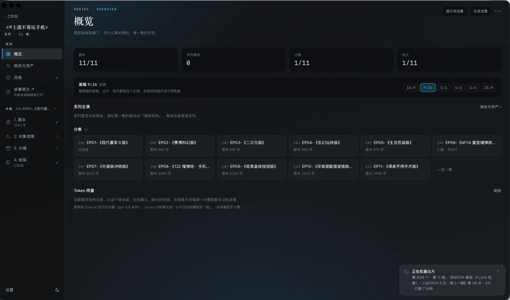
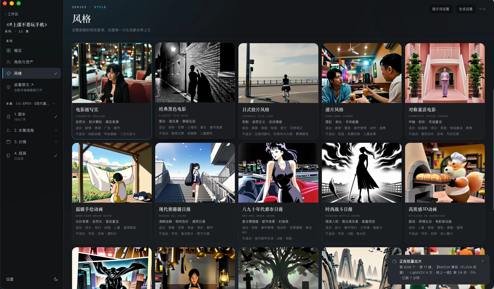
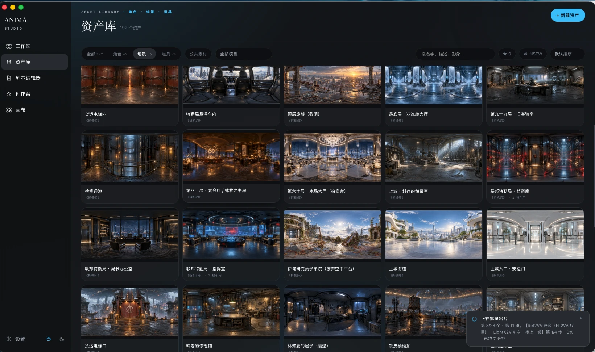
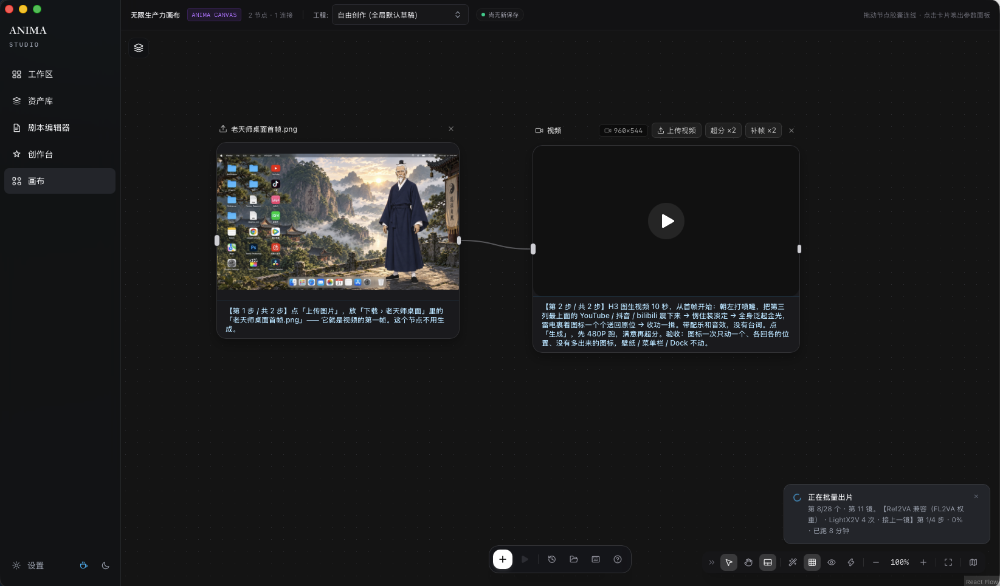
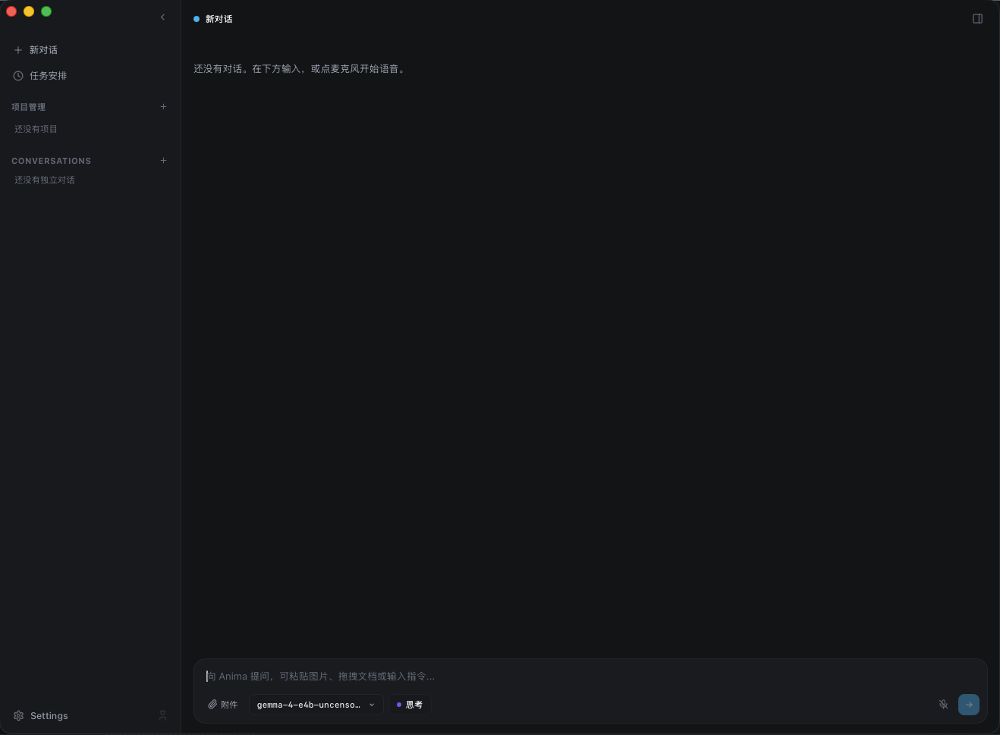
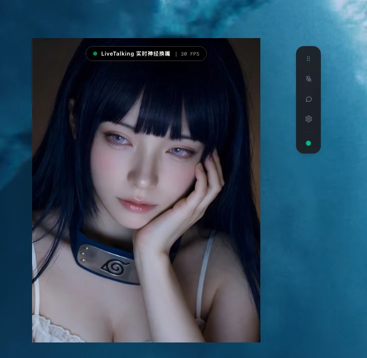

<p align="right"><a href="./README.md">English</a> | <b>简体中文</b></p>

# Anima

**本地优先的 AI 短剧工作室 + 语音数字人，跑在 Apple Silicon 的 Mac 上。**

从一份中文剧本出发，在本机完成「剧本 → 资产 → 分镜 → 带中文配音和口型的视频 → 剪辑成片」整条短剧生产线；
同时也是一个可以实时语音对话、能被打断、有记忆、有面容、能调用工具的 AI 助手。

当前状态：**个人原型，持续开发中**（版本见 `package.json`）。不提供安装包，需要从源码构建。

- [截图](#截图)
- [功能](#功能)
  - [短剧工作台](#一短剧工作台studio)
  - [无限画布](#二无限画布)
  - [语音助手与数字人](#三语音助手与数字人)
  - [AI 代理与工具](#四ai-代理与工具)
  - [系统与运维](#五系统与运维)
- [技术栈](#技术栈)
- [环境要求](#环境要求)
- [快速开始](#快速开始)
- [目录](#目录)
- [许可](#许可)

---

## 截图

<table>
<tr>
<td width="50%"><br><sub>系列概览：剧本 / 角色 / 分镜 / 成片进度，分集状态，画幅</sub></td>
<td width="50%"><br><sub>风格：整部剧的视觉基调，每种风格写明适合与不适合的题材</sub></td>
</tr>
<tr>
<td><br><sub>资产库：角色、场景（360° 全景）、道具</sub></td>
<td><br><sub>无限画布：节点连线即数据流，节点上写明每一步做什么</sub></td>
</tr>
<tr>
<td><br><sub>对话：本地 / 云端模型切换、思考强度、语音输入</sub></td>
<td><br><sub>角色形态：电子云、Live2D、3D VRM、写实视频，各配声音与面容</sub></td>
</tr>
<tr>
<td><br><sub>数字人：实时神经换嘴（30 FPS）</sub></td>
<td></td>
</tr>
</table>

---

## 功能

### 一、短剧工作台（Studio）

工作区按 **系列 → 分集 → 分镜** 组织，六步流水线：剧本 → 风格 → 资产 → 分镜 → 出片 → 组装。
每一步都能在界面上做，也都能通过 MCP 交给 AI 代理驱动。

**剧本**
- 富文本剧本编辑器（TipTap），剧本库管理多份原文 / 设定文档。
- 原文改编成剧本、生成改编方案（哪几章并成一集、每集兑现什么）。
- 按场标题自动分场；剧本行分类（台词 / 动作 / 屏幕文字 / 场景标题）。
- 编剧手艺库：改编时按需取用。

**风格**
- 整部剧统一画风：内置风格预设 + 自定义风格词。
- 风格广场：同一个镜头铺开多个风格并排比较。
- 读剧本推荐风格。

**资产**
- 从剧本抽出角色 / 场景 / 道具，人看过再建库；系列级资产池，分集资产可收进系列。
- 角色外观规格槽位化（长相 / 身材 / 服装分开），**多套造型**，单镜可覆盖；角色可以合并成另一角色的一个造型。
- 设定图管线：三视图、表情、动作、多视图设定卡、七分区参考表；角色视觉基因锚点；人设模板（不需要底图）。
- 出图质检：生成完先验一遍再收下。
- 场景空间契约：用文字地图锁住地理关系。
- 项目封面、分集封面自动生成；公共素材库。

**分镜**
- 后台模型生成镜头表：景别、机位、运镜、职责、站位、光线、台词（逐句情绪、音色）、时间段、出场资产。
- 「一场一镜出」模式：不分镜，镜内按时间轴切镜。
- 细化时间线：把一镜从第 0 秒写到最后一秒。
- 时间线检查：遮挡、背后看不到的动作、台词说不完、交接区开口等「H3 会照着画错」的写法，生成前提示。
- 镜头语言统一词表；程序化 ControlNet 控制图。
- **导演世界**：全景 / 3DGS 片场里摆机位、摆人偶、调姿势、定站位，跨镜头沿用。

**合成提示词与出片**
- 两条提示词线路：中文结构填空（线路 A）、MiniMax H3 官方六段格式（线路 B，官方规范编译进程序）。
- 台词语气：情绪、音色、重音、停顿逐句写进提示词（需要时才加）。
- 每镜自动判断出片方式：**首帧出片**（FL2VA）或**参考出片**（Ref2VA），也可手动指定；接上一镜（运镜 / 光线连续）。
- 引擎：**MiniMax H3**（台词直接生成同步中文语音和口型，能说方言）、**LTX-2.5**（快约 10 倍）。
- 长镜头（一场整段出）、超长镜（单镜超过 15 秒自动分段，一次交给 H3 窗口链）。
- 画质档位（LightX2V / Larry 4 步 / 6 步 / 稠密）× 清晰度（480P / 576P / 720P），出片前给出按实测数据估算的耗时。

**任务与队列**
- 批量出片 / 批量出首帧 / 资产批量出图都是后台任务；队列可拖动改顺序、插暂停位，连在一起的镜头成组移动。
- **应用重启后接着收**：正在跑的那一镜去 ComfyUI 收结果，批量里没轮到的重新排上。
- 进度看 ComfyUI 的实际采样步数，不按固定超时判失败；出片期间阻止 Mac 睡眠，出片前卸载本地大模型腾内存。

**组装与导出**
- 按镜头顺序拼成一集；长镜头占一格。
- 逐角色音色配音（TTS 路线，与 H3 原声二选一）、硬字幕。
- 导出 **Final Cut Pro**（FCPXML 1.11）和**剪映**草稿工程。
- 模型用量账本：每次调用花了多少 token，记在哪个后端、哪个模型。

### 二、无限画布

节点式工作流（交互参考 LibTV），节点之间连线就是数据流。

**节点**：提示词、图片生成、视频生成、音频 / 音频片段、角色、LoRA、技能、镜头 / 镜头上下文、
深度动作捕捉、超分、全景、全景查看器、导演世界、分组。

**能力**
- 文生图、图生图、多视图设定卡、姿势控制；首帧 / 首尾帧 / 参考生视频、参考音频。
- **超长视频**：H3 时长可拉到 75 秒，还是点「生成」，后台按提示词里的时间码分段（没写时间码交给后台模型拆），一次串成一整条。
- 长镜头窗口表：一个节点、一张窗口表，一次提交出一个 MP4。
- 动作迁移（深度 / Canny 控制）、原片复刻。
- 抠图、超分（RealESRGAN）、补帧（RIFE）、视频超分。
- 360 全景拆立方体面；单张场景图重建 3DGS 片场（Apple SHARP）。
- 风格广场：挑 LoRA 或提示词风格；按引擎核对 LoRA 架构（读 safetensors 张量键名，不靠文件名）。
- 拖出连线到空白处弹出新建节点菜单；节点左右都有「+」。
- 工作流存成模板，保存前自动检查会静默出错的接法；生成结果存到「下载」。
- 每个节点显示自己任务的进度；后台任务，页面刷新、应用重启都能取回结果。

### 三、语音助手与数字人

**多模型网关**
- 五个适配器：OpenAI、Azure OpenAI、Claude、OpenAI 兼容（LM Studio / MLX）、Ollama 原生 `/api/chat`。
- 模型列表从后端实时拉取；实时 / 后台双层路由；带工具的请求遇到不支持的后端自动回退。
- 流式输出统一成文本 / 推理过程 / 工具调用三类事件；思考强度可调；每条流可随时取消。

**实时语音**
- 麦克风采集（cpal）→ Silero VAD 断句 → Whisper 识别（whisper.cpp + Metal）→ 大模型流式 → 逐句 TTS → 播放（rodio）。
- **全程可被用户开口打断**（barge-in，可取消的状态机）。
- 主动开口、定时提醒、多种对话模式。
- TTS 引擎：Edge TTS（免费、无需 key）、CosyVoice、IndexTTS、GPT-SoVITS、OpenAI 兼容接口（如 Kokoro、F5-TTS）；按情绪挑参考音色、音色库。

**记忆与性格**
- SQLite（会话、元数据）+ LanceDB（向量）双轨记忆：对话落库、后台提取事实、去重合并、摘要、语义召回注入上下文。
- 本地知识库、任务台账（按任务记忆）。
- 性格养成：好感度 / 心情 / 活跃度等情感轴，驱动系统提示词和面部微表情。
- 技能（角色扮演）：一个技能同时切换身份、方法和可用工具。

**数字人面容**
- 电子云粒子形态（Shader）、内置头、自带 `.glb` / VRM 模型、Live2D。
- 文字 → 拼音 → Oculus Viseme 时间线驱动口型，换任何 TTS 都成立；自动识别三套 morph target 命名（Oculus / ARKit / 五元音）。

### 四、AI 代理与工具

- 带工具的对话循环；工具分级授权、执行前确认、Tauri capability 白名单限定范围。
- **MCP 客户端**：接本地 / 远程工具服务，含权限守卫、资源、提示词。
- **MCP 服务端 `anima-mcp`**：把 Studio 的能力（建项目、导剧本、建资产、出镜头表、合成、出片、拼接……）暴露给 Claude Code 等代理。
- 出图 / 出片工具：Z-Image、Qwen-Image、Krea 2、SDXL（LoRA / ControlNet），MiniMax H3、LTX-2.5，经 ComfyUI + WeeTodd MLX 节点。
- 研究与网页抓取、代码大纲、LSP、交互式终端（PTY）、git worktree、子代理。
- 定时任务、音乐播放（网络电台 + 控制本机 Music.app）。

### 五、系统与运维

- `anima` 启动器：一条命令拉起 / 关闭 Ollama、LM Studio、ComfyUI、TTS 服务并注入密钥；`anima doctor` 体检。
- 诊断页：把「不报错的失败」摆到台面上（例如 ComfyUI 少了 `--fp32-unet`）。
- 服务页：看本机依赖谁在跑。
- 应用自更新（本机拉代码重新构建）、构建垃圾回收。
- 多窗口、单实例、界面中英文（i18next）、深浅色主题。
- 密钥开发期放 `.env.local`，打包版用 macOS Keychain。

---

## 技术栈

| 层 | 技术 |
| :--- | :--- |
| 客户端外壳 | Tauri 2（Rust），单实例插件 |
| 前端 | React 19 · TypeScript · Vite · Tailwind CSS · Zustand · i18next |
| 画布 | React Flow（@xyflow/react） |
| 3D / 面容 | Three.js / React Three Fiber · Gaussian Splats 3D · Pixi.js + Live2D |
| 编辑器 | TipTap · react-markdown |
| 异步与网络 | Tokio · reqwest（rustls）· tokio-tungstenite · SSE / NDJSON 解码 |
| 大模型 | OpenAI · Azure OpenAI · Anthropic Claude · LM Studio · Ollama · MLX server |
| 语音 | cpal / rodio · Silero VAD（ONNX Runtime）· whisper-rs（whisper.cpp + Metal）· Edge TTS · CosyVoice · IndexTTS · GPT-SoVITS |
| 存储 | SQLite（rusqlite，WAL）· LanceDB（Arrow）· macOS Keychain（keyring） |
| 出图出片 | ComfyUI · WeeTodd MLX 节点 · MiniMax H3 · LTX-2.5 · Z-Image · Qwen-Image · Krea 2 · SDXL |
| 媒体处理 | ffmpeg · RealESRGAN · RIFE · Apple SHARP（3DGS） |
| 工具协议 | MCP（rmcp）· LSP（lsp-types）· portable-pty |
| 测试 | Vitest · cargo test（含 mock HTTP 服务的协议级集成测试） |

## 环境要求

- **macOS + Apple Silicon**。开发机是 M4 Max / 128 GB 统一内存；视频生成很吃内存，小内存机器只能跑轻量部分。
- Node.js、Rust 工具链（`rustup`）、`brew install protobuf`（LanceDB 需要）、ffmpeg。
- [Ollama](https://ollama.com)：`ollama pull bge-m3`（记忆层的嵌入模型，必须多语言）。
- 可选：[LM Studio](https://lmstudio.ai) 跑本地大模型。
- **出图 / 出片要 ComfyUI**，以及 WeeTodd 的 MLX 节点和对应模型权重。
  **本仓库不分发任何模型权重**，需要自己下载，各模型遵循各自的许可（有些禁止商用）。
  ComfyUI 在 Apple Silicon 上要带 `--fp32-unet` 启动，否则视频会是纯黑（`scripts/anima.sh` 会处理）。

## 快速开始

```bash
npm install
cp .env.example .env.local && chmod 600 .env.local   # 只在要用云端大模型时填 key
./scripts/anima.sh doctor     # 体检：工具链、模型、服务、缺什么怎么装
./scripts/anima.sh start      # 拉起依赖服务 + 应用
```

只起应用本体：

```bash
npm run tauri:dev
```

一个 key 都不填也能跑：本地 LM Studio / Ollama 不需要 key，语音默认走 Edge TTS。
**开发期不要把 key 存进 macOS Keychain**（每次编译都会反复弹授权框），原因见 `.env.example`。

**测试**

```bash
npm test                                   # 前端（Vitest）
cd src-tauri && cargo test --lib           # Rust
npm run build                              # 类型检查 + 前端构建
```

打真实服务的联调测试默认 `#[ignore]`，需要本机服务在跑。

## 给 AI Agent 用（Claude Code / Codex）

把这个链接交给 Agent，让它照着装：

- 技能：[`agent-skills/anima/SKILL.md`](https://github.com/eliliu911/Anima/blob/main/agent-skills/anima/SKILL.md)（纯文本：https://raw.githubusercontent.com/eliliu911/Anima/main/agent-skills/anima/SKILL.md）

里面有完整步骤：编译 `anima-mcp`（stdio MCP 服务端）→ `claude mcp add` / `codex mcp add` 接上 → 把这份文件装成技能 → 验证。
装好之后 Agent 能建项目、导剧本、建资产、出分镜、合成提示词、出片、拼接成集；不暴露 shell、文件读写和私人记忆库。

## 目录

```
src/                  React 前端（Studio、画布、设置、语音界面）
src-tauri/            Rust 后端
  src/llm/            多模型网关
  src/voice/ audio/ stt/ tts/   语音管线
  src/memory/         SQLite + LanceDB 记忆
  src/avatar/         口型时间线
  src/agent_runtime/  代理运行时与工具（出图、出片、ComfyUI、MCP 桥……）
  src/mcp/ mcp_server/   MCP 客户端 / 服务端
  src/bin/            anima-mcp 等独立工具
skills/               给后台模型 / 代理用的技能（第三方技能各自目录里有许可）
shared/               前后端共用的提示词模板和词表
comfyui-nodes/        给 ComfyUI 补的小节点
workflows/            ComfyUI 工作流示例
scripts/              启动器、体检、辅助脚本
docs/ARCHITECTURE.md  架构设计
```

## 许可

**双许可**：

- **非商业使用**免费：[PolyForm Noncommercial License 1.0.0](./LICENSES/PolyForm-Noncommercial-1.0.0.txt)（个人、学习、研究、非营利机构）。
- **商业使用**需要另外取得授权：请在 [Issues](https://github.com/eliliu911/Anima/issues) 里联系。

例外：改写自 DramaClaw（ClaymoreLab）的文件仍按 [Elastic License 2.0](./LICENSES/ELv2.txt)，清单见 [`NOTICE`](./NOTICE)；
`skills/` 下的第三方技能按各自目录里的许可。完整说明见 [`LICENSE`](./LICENSE)。

Copyright (c) 2026 SONG LIU
