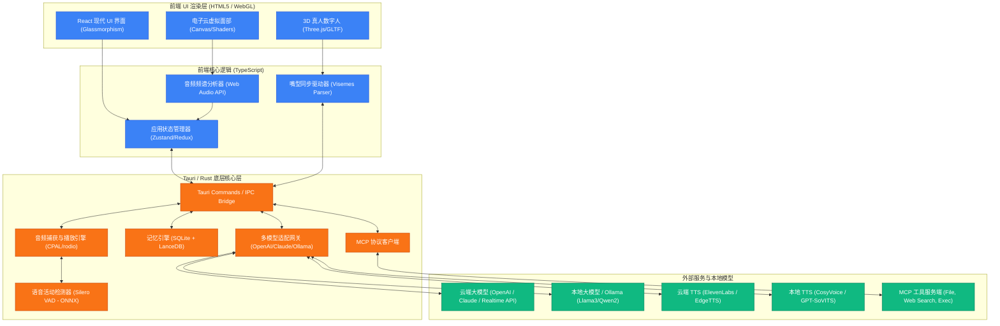
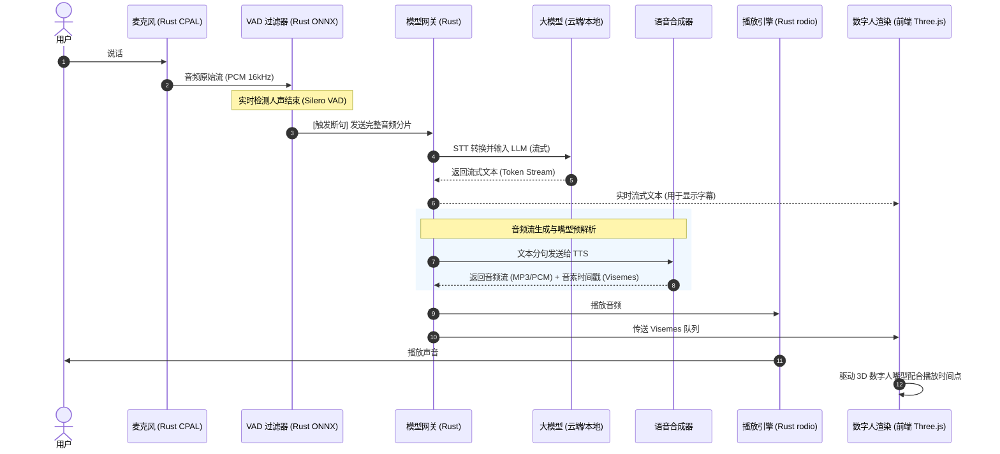
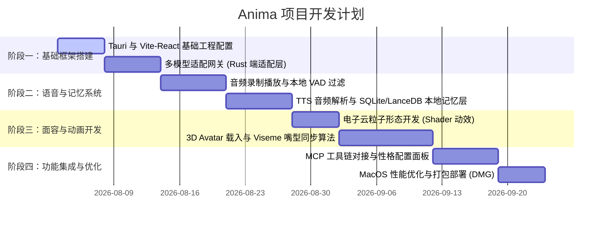

# Anima 架构设计方案

> 跨平台 AI 语音数字人助手 —— 项目代号 **Anima**

本方案旨在设计一个运行于 MacOS（当前开发平台）并支持跨平台移植的 AI 助手。该助手集成多大模型适配器、低延迟实时语音流水线、性格与本地记忆系统、MCP 工具调用以及双模数字人面容渲染（电子云虚拟面部与 3D 模拟真人）。

定位：个人使用 / 原型验证阶段，架构从简，暂不考虑多用户账号体系、License 分发等产品化部分；数字人面容采用分阶段策略，先做 2D/电子云形态验证交互闭环，再扩展 3D 真人形态。

目标硬件：Mac Studio (M4 Max, 128GB 统一内存)，本机已同时部署 LM Studio、Ollama、MLX server 三套本地推理服务，架构设计以此为基准环境。

---

## 1. 核心技术选型 (Recommended Tech Stack)

为了满足跨平台、高性能、轻量化以及 3D WebGL 渲染的需求，推荐采用 **Tauri + Frontend (Vite + React + Three.js) + Backend (Rust)** 的架构体系。

| 模块 | 技术选型 | 选用理由 |
| :--- | :--- | :--- |
| **客户端外壳** | **Tauri (Rust)** | 包体积极小（约 15-20MB），内存占用低，底层 Rust 对操作系统 API（音频流输入输出、子进程管理）具备极强的控制力，天生跨平台（MacOS, Windows, Linux）。 |
| **前端界面与 3D** | **Vite + React + Three.js / React Three Fiber** | 现代响应式 UI，Three.js 拥有庞大的 GLTF 3D 模型渲染生态，支持 Blendshapes 混合变形，实现高性能嘴型同步（Lip-Sync）渲染。 |
| **多模型适配** | **统一 REST API/WS 适配器** | 统一封装 OpenAI（包括 Realtime API）、Claude，以及任意 OpenAI 兼容的本地推理端点（LM Studio / Ollama / MLX server 均可插拔配置）。 |
| **本地记忆与向量库** | **SQLite + LanceDB (Rust-embedded)** | SQLite 用于静态性格、会话元数据存储；LanceDB 作为无 Server 的嵌入式向量数据库，支持高速本地向量检索，非常适合桌面端打包。 |
| **实时语音处理** | **Rust cpal / rodio + Web Audio API** | Rust 层用于捕获低延迟系统麦克风音频、播放 TTS 音频流；Web Audio API 用于前端做实时频谱分析（用于电子云动效和嘴型驱动）。 |

---

## 2. 系统总体架构图

下图展示了系统的核心分层设计，主要分为：**UI 渲染层**、**前端逻辑控制层**、**Rust 底层核心层** 和 **外部服务层**。



---

## 3. 核心功能模块设计

### 3.1 实时语音对话管线 (Real-Time Audio Pipeline)

为了实现自然、无卡顿的语音交互，语音管线必须支持**流式输入 (Streaming Input)** 与**流式输出 (Streaming Output)**，并引入 **VAD (Voice Activity Detection)**。



**超低延迟优化方案：**

1. **使用 OpenAI Realtime API (WebRTC)**：允许在单个 WebSocket/WebRTC 连接中传输双向音频，省去传统 `STT -> LLM -> TTS` 的多次 API 握手开销，延迟可降低至 1 秒以内。
2. **本地 VAD 过滤**：在 Rust 端集成基于 WebAssembly/ONNX 的 Silero VAD。只有检测到用户真正开始说话和结束说话时，才与云端通信，避免频繁无意义的网络请求。

---

### 3.2 多模型集成适配层 (LLM Adapter Layer)

系统定义统一的 `LlmConnector` Trait (Rust)，不同的模型供应商实现各自的适配器。

```rust
// Rust 伪代码：统一的模型接口定义
#[async_trait]
pub trait LlmConnector {
    // 流式文本交互
    async fn chat_stream(
        &self,
        prompt: &str,
        history: Vec<Message>,
        tools: Vec<Tool>
    ) -> Result<BoxStream<'static, ChatResponseChunk>, Error>;

    // 实时语音交互 (支持双向音频协议如 OpenAI Realtime)
    async fn establish_realtime_session(
        &self,
        audio_sink: AudioSink
    ) -> Result<RealtimeSession, Error>;
}
```

- **云端 (OpenAI, Claude)**：使用官方 SDK 的 REST/WebSocket 流式接口。
- **本地推理端点**：不绑定单一后端，配置层只存 `base_url + model name + 后端类型`，指向本机已有的 LM Studio / Ollama / MLX server 中的任意一个，运行时可在设置里切换，无需改代码。

#### 3.2.1 本地推理后端选择与实时/后台双层路由

本机（Mac Studio M4 Max，128GB 统一内存）同时跑着 LM Studio、Ollama、MLX server 三套服务，三者各有取舍，需要在网关层区别对待：

| 后端 | 特点 | 建议用途 |
| :--- | :--- | :--- |
| **LM Studio** | `/v1/chat/completions`、`/v1/responses` 均为成熟的 OpenAI 兼容实现，流式 + 工具调用（含流式 tool-call 参数）支持稳定；底层可直接跑 MLX 引擎，等于免费拿到 MLX 的速度，且不用自己处理 MLX 的 Rust 绑定问题（MLX 官方对 Rust 支持较弱）。 | **推荐作为默认本地后端**，尤其是需要工具调用的场景。 |
| **Ollama** | 原生 `/api/chat` 的流式 + 工具调用没问题；但 OpenAI 兼容层 (`/v1/chat/completions`) 在 `stream=true` 时有已知 bug，会静默丢弃 tool_call。 | 可用，但涉及 MCP 工具调用时务必走原生 `/api/chat`，不要走 OpenAI 兼容层。 |
| **MLX server (`mlx_lm.server`)** | 裸推理速度最快，但工具调用支持目前是三者中最不成熟的，第三方还在打补丁。 | 仅建议用于不需要工具调用的纯聊天/情感对话场景。 |

**实时对话 vs 后台复杂任务的双层路由**：网关内部按任务类型路由到不同尺寸的模型，对上层（语音管线、MCP 调度）透明：

- **实时语音链路**（目标端到端延迟 1-2 秒）：优先用 **Qwen3-Coder-30B-A3B**（MoE，每 token 仅激活约 3.3B 参数）经 LM Studio/MLX 引擎跑，M4 Max 上实测可达 70-100+ tok/s，工具调用能力优于同量级稠密模型；追求更低延迟也可以退到 Qwen3 8B 稠密模型。
- **后台/非实时复杂任务**（多步 MCP 编排、记忆整理、深度推理）：可以调用 **Llama 3.3 70B (Q4)** 或 **Qwen3 32B** 这一档，工具调用准确率更高，但 M4 Max 上大约只有 20-28 tok/s，不适合放进用户干等的实时对话轮次，应做成异步任务、跑完再通知或补充上下文。

**内存与并发配置**：128GB 统一内存下，模型不再是稀缺资源，可以让"快速小模型（意图/情绪打分）+ 主对话模型 + Embedding 模型"三者同时常驻，避免频繁加载/卸载：

- 预留 8-16GB 给 macOS 和其他 App，其余可通过 `sudo sysctl iogpu.wired_limit_mb=<值>` 提高 Metal 默认的 75% 显存上限，把可用显存进一步打开。
- Ollama 用 `OLLAMA_MAX_LOADED_MODELS` / `OLLAMA_NUM_PARALLEL` 控制并发常驻模型数；LM Studio 的 server 模式同样支持多模型常驻。

---

### 3.3 性格养成系统 (Personality & State Engine)

性格养成系统决定了助手的回答语气、口癖、动作表情以及好感度。

1. **性格配置文件 (Schema)**
   - 基础人设：姓名、年龄、职业、核心背景、口癖（如经常使用某个词结尾）。
   - 情感轴 (Emotion Coordinates)：好感度 (Affection)、心情 (Mood - 兴奋/平静/沮丧)、活跃度 (Energy)。

2. **情感与动作推理环**

   ```mermaid
   graph LR
       UserMessage["用户输入 (情感色彩)"] --> EmotionLLM["大模型情感提取/打分"]
       EmotionLLM --> StateUpdate["更新本地 SQLite 情感数值"]
       StateUpdate --> SystemPrompt["生成包含当前情绪的 System Prompt"]
       StateUpdate --> ActionTrigger["触发 3D 数字人微表情/动作指令"]
   ```

3. **系统提示词拼接器**：在发送请求给大模型前，引擎根据当前的情感数值（例如好感度：90，心情：兴奋）动态把如下提示词插入 System Prompt：

   > "你目前心情非常激动且对用户极度友好。你的说话语气应该活泼欢快，适度运用感叹号。"

---

### 3.4 本地记忆系统 (Memory System)

基于双轨制记忆系统设计：

```
                              ┌──────────────────┐
                              │  用户/助手 对话   │
                              └────────┬─────────┘
                                       │
                    ┌──────────────────┴──────────────────┐
                    ▼                                     ▼
        ┌───────────────────────┐             ┌───────────────────────┐
        │ 长期记忆 (检索)        │             │ 静态状态与元数据        │
        │ [LanceDB 向量数据库]   │             │ [SQLite 关系数据库]    │
        └───────────┬───────────┘             └───────────┬───────────┘
                    │                                     │
                    ├─────────────────────────────────────┤
                    ▼                                     ▼
        ┌─────────────────────────────────────────────────────────────┐
        │                  上下文拼装器 (Context Assembler)           │
        └──────────────────────────────┬──────────────────────────────┘
                                       ▼
                             [ 最终输入给大模型 ]
```

1. **短期工作记忆 (Sliding Window Buffer)**：缓存最近的 10-15 次对话轮次，保持对话连贯性。
2. **长期记忆 (Vector DB - LanceDB)**：
   - 当检测到一段对话结束或闲置时，Rust 异步启动一个轻量大模型（或规则提取器），提取本轮对话中的"事实 (Facts)"，如：`{"subject": "用户", "fact": "养了一只叫小黑的猫"}`。
   - 对提取到的 Facts 进行 Embedding，存入 **LanceDB**。
   - 每次用户提问时，使用用户的 Prompt 进行相似度检索，召回相关的 Facts 作为背景知识注入模型。

---

### 3.5 数字人面容渲染系统 (Face Rendering Engine)

系统提供两种完全不同的面容形态，用户可一键切换，按路线图分阶段实现（先电子云形态，再 3D 真人形态）。

**方案 A：电子云虚拟面部 (Abstract Cyber Face) —— 第一阶段实现**

适合追求科幻感、低配置损耗的场景。

- 前端利用 React Three Fiber / WebGL 渲染一个三维粒子球。
- 使用 **Web Audio API** 的 `AnalyserNode` 获取 TTS 输出音频的实时频率数据 (ByteFrequencyData)。
- 将频率数据作为 Uniforms 传入 GLSL Vertex Shader，驱动粒子球做节奏性收缩、扩张、波浪起伏与颜色渐变。
- 用户未说话时，粒子呈平静呼吸态；助手说话时，随音频振幅剧烈跳动。

**方案 B：3D 模拟真人形态 (3D Realistic Avatar) —— 第二阶段实现**

适合高拟真、陪伴式的场景。

- **模型源**：使用 Ready Player Me 的标准 GLTF 模型，包含标准的 Face Blendshapes (Apple ARKit 规范，含 52 个表情通道，如 `jawOpen`、`mouthSmile` 等)。
- **嘴型同步 (Lip-Sync)**：当 TTS 生成音频时，同时获取其关联的 **Visemes（音素列表与时间戳）**。例如，中文的"啊"对应音素 `aa`，映射到 Blendshapes 中的 `jawOpen: 0.8`、`mouthFunnel: 0.3`。前端计时器根据音频播放进度，实时通过 `requestAnimationFrame` 对 Blendshapes 的权重进行插值平滑变化，实现栩栩如生的对口型效果。
- **微动作生成 (Idle Animations)**：编写随机算法驱动数字人进行眨眼 (`eyeBlinkLeft`, `eyeBlinkRight`)、眼球微幅转动以及身体的呼吸起伏，使 3D 数字人充满生命感。

两种形态共用同一套"音频/Visemes 驱动接口"（渲染后端抽象层），因此从方案 A 切换到方案 B 时无需改动语音管线与状态管理逻辑。

---

### 3.6 MCP (Model Context Protocol) 工具调用

系统作为 MCP 客户端，可以连接各种本地/远程 MCP 服务，极大扩展助手的实际工作能力。

1. **MCP 客户端生命周期**
   - Tauri (Rust) 在后台拉起配置好的 MCP Servers（通常是 Node.js 或 Python 编写的 CLI 进程），通过 **Stdio**（标准输入输出）建立通信管道。
   - Tauri 获取各 Server 导出的 Tools 声明，在对话开始前传递给 LLM 适配器。

2. **工具执行流**
   - 当 LLM 决定调用某个工具时，返回 `tool_calls`。
   - Tauri 捕获该调用，在 Rust 侧安全沙箱内执行对应的 MCP 动作（如读取 MacOS 本地文件、运行 Shell 脚本、执行 Web 搜索）。
   - 将执行结果回传给 LLM 产生最终回复。

---

## 4. MacOS 平台的本地优化 (MacOS Optimization)

1. **Metal 硬件加速**
   - 本地大模型 (Ollama / Llama.cpp) 自动启用 MacOS Apple Silicon (M1/M2/M3) 的 GPU/Unified Memory (Metal) 加速。
   - 3D 渲染端通过 WebGL 充分利用 Metal API 进行硬件图形加速。

2. **系统级快捷键与菜单栏**
   - Tauri 可以轻松实现 `MenuBar` 驻留（常驻系统菜单栏的小图标）。
   - 支持全局快捷键（如 `Option + Space`）唤醒悬浮数字人窗口。

3. **系统音频回声消除 (AEC)**
   - 播放 TTS 音频时，如果麦克风同时开启，可能会录入自己播放的声音。
   - Rust CPAL 音频引擎可以配合 CoreAudio 设置，启用 MacOS 系统的回声消除特性，保证实时语音不受扬声器干扰。

---

## 5. 个人项目/原型阶段的简化建议

由于当前定位为个人使用/原型验证，架构上可以先跳过以下部分，待后续需要对外发布时再补充：

- 多用户账号体系、云端同步、License/订阅管理。
- API Key 只需存本地（推荐 macOS Keychain 而非明文配置文件），无需服务端密钥托管。
- 打包分发暂用 Tauri 自带的 `.dmg`/`.app` 本地构建即可，不需要自动更新服务器。
- 遇到崩溃/异常直接看本地日志文件，暂不需要接入远程崩溃上报平台。

---

## 6. 性能与并发注意事项 (Performance & Concurrency Pitfalls)

以下是设计/实现阶段需要提前规避的坑点：

1. **IPC 不是免费的**：Tauri 的 Rust↔WebView 通信要走 JSON 序列化。音频频谱、viseme 数据这类高频数据不要按"每帧一次 command"的方式传，应走 Tauri 的 event 广播或本地 WebSocket，避免序列化开销拖累帧率。
2. **打断 (barge-in) 必须做成可取消的状态机**：用户在 TTS 播放中开口说话时，要能立刻取消当前 LLM 生成流、清空待播放音频队列，否则会出现新回答叠在旧语音上、或模型还在回答上一轮问题的现象。Rust 端用 `CancellationToken`/`select!` 把 STT→LLM→TTS 整条链路做成可随时中断，而不是简单顺序 await。
3. **共享状态的竞态**：情绪值更新、记忆写入这些后台任务和主对话流是并发的，建议用 actor 模式或显式加锁管理"性格/情绪状态"，避免多个 async 任务直接改同一份裸共享数据。
4. **SQLite 并发写**：开启 WAL 模式，情绪值/记忆写入做批量或节流，避免每个 token 都触发一次磁盘 IO。
5. **3D 场景切换的内存泄漏**：切换 2D↔3D 形态时，Three.js 的 geometry/material/texture 要手动 dispose；GLTF 模型建议预加载+缓存，避免每次切换重新加载卡顿。
6. **MCP 工具执行的安全边界**：Rust 侧执行 shell/文件类 MCP 工具时，用 Tauri v2 的 capability/scope 配置做白名单（限制可访问目录、可执行命令），不能让模型的 tool_call 直接拿到无限制的系统权限。
7. **回声消除别全信系统默认**：CoreAudio 的 AEC 在外接音箱等场景下不一定可靠，建议留一个"播放时自动降低麦克风增益"或 push-to-talk 的降级方案作为保底。
8. **本地大模型的工具调用可靠性有上限**：小模型能生成语法正确的 JSON tool call，但多步骤 agentic 推理、参数正确性、报错后的自我修正明显弱于云端旗舰模型（现状大致相当于云端模型 2024 年初的水平）。建议实际用你的 MCP 工具 schema 跑一轮验证，而不是假设"随便一个本地模型"就能顶起工具链；必要时对复杂/高风险工具调用回退到云端模型。

---

## 7. 项目开发路线图 (Development Roadmap)


